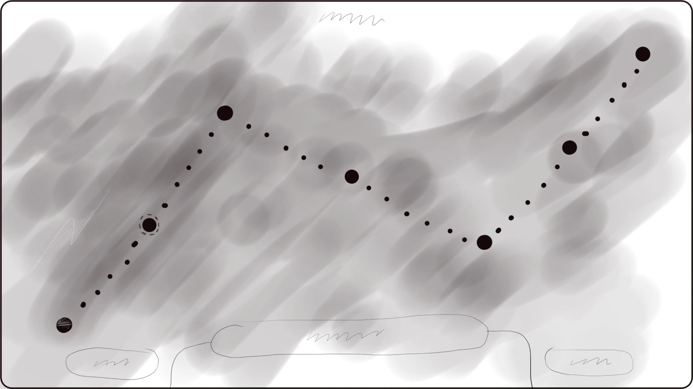
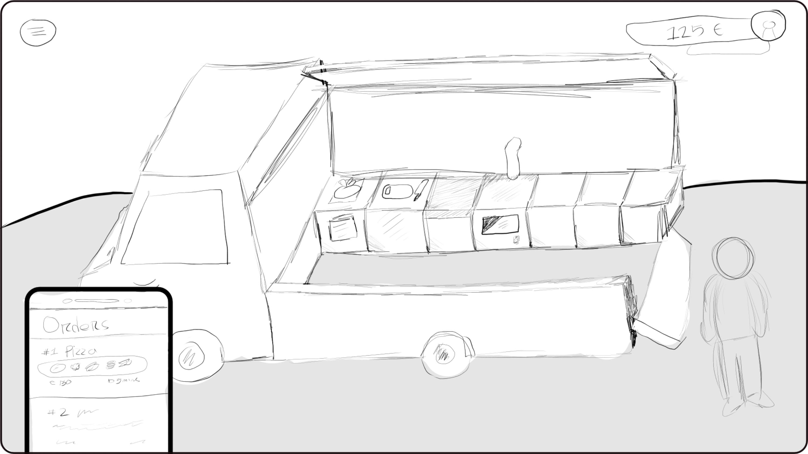
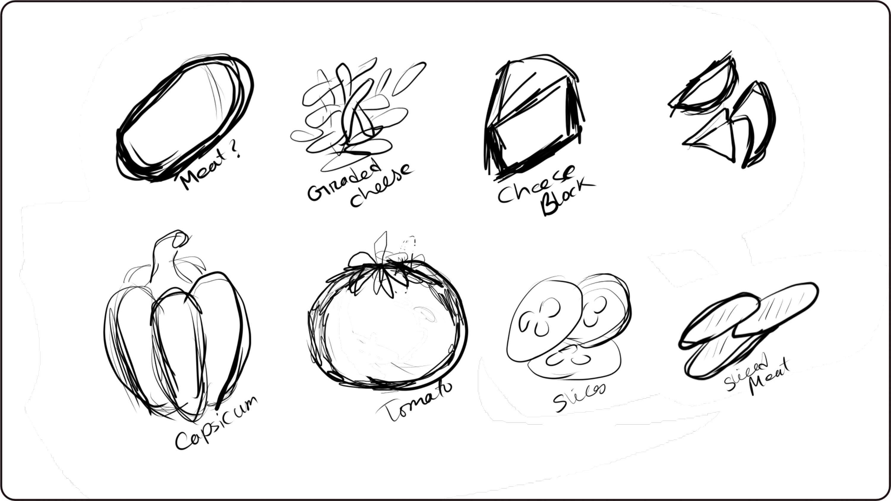
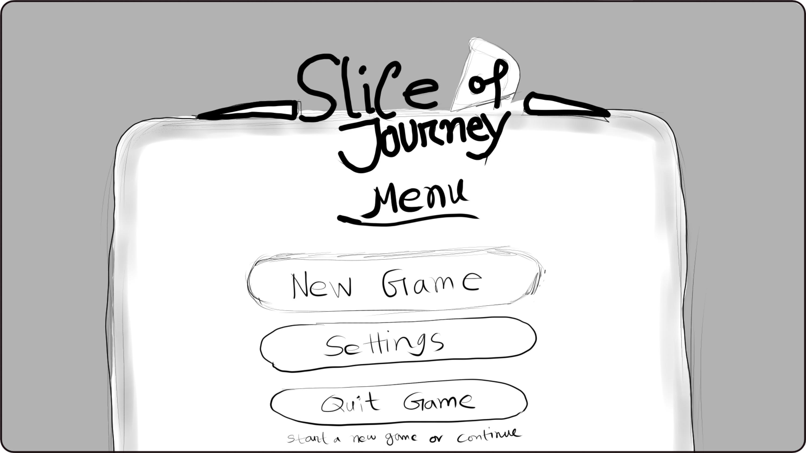

# Slice of Journey

> Game Design Document (GDD)

## Executive Summary

Slice of Journey is a 3D birds-eye view fast-paced strategic single-player cooking and time management game in which the players cook and deliver food orders by preparing and assembling the orders within a given time frame, in the same time managing inventory and economy.

The gameplay includes elements of action, strategy, and resource management with increasing complexity by progressing through levels and introducing different elements such as cutting, cooking, and baking food items and managing the economy.

## Target Audience

The game targets mid-core and casual players, aged 13 and above, who enjoy simulation and management games with cooking or restaurant-based gameplay mechanics.

Main target audiences are, players who :
- enjoy quick, engaging play sessions
- likes optimization and multi-tasking
- are casual to mid-level gamers

## Main Charecters

An animated 3D customizable cute cartoony chef, who acts as the player and is controlled by the player to interact with other objects *(kitchen stations)* in the game. The charac

## Main Features

### Core Mechanics

The player receives orders in the bulletin board, and prepares food by interacting with different stations in the kitchen, such as container counters, cutting counters, ovens, and delivery counters. Each dish requires a set of ingredients and preparation steps that need to be completed by the player to receive rewards and reaching the level goal.

The orders need to be fulfilled by the player in time by delivering the right dish to the customers and earning money accordingly. The wrong orders will result in penalties or failed feedback. Player wins a level if they completed all the orders in time.

The player also manages a inventory of the ingredients, if out of stock, they need to buy items from shop which balances the earning-spending economy. If a level is failed the earning for the session is not added to global economy.

### Movement

Simple directional keyboard *(WASD/arrow keys)* input or game controller can be used to navigate the 3D world. Player movement contains collision detection and auto rotation towards the direction of movement.

The interaction with the kitchen environment is directional and proximity-based, which requires the player to face the object and be close to it to interact with it.

### Physics

The game employs simple collision-based physics. However, this is mainly for movement and interaction detection. There's no complex simulated physics involved. Instead, objects are simply attached or detached.

Objects are also parented to the player or kitchen counters instead of using complex rigid body dynamics for stable and predictable gameplay.

### Multiplayer Mode

The game is initially designed for single-player mode. However, the modular design of the counters, the interaction with the player, and the order system can easily accommodate co- op multiplayer mode. Players can then work together in the same kitchen.

## Genre, Setting, Concept Art

**`Genre`**: Casual, Strategy, Cooking Simulation, Time Management

**`Visual Style`**: Bright, Colourful, Stylized, Low-poly, Clear Visual Feedback

**`Setting`**: The game takes place in a dynamic kitchen environment carried on a RV (recreational vehicle), which has a stylized look. Players control cooking stations, which are arranged in a grid-like fashion. Each level takes place in a different kitchen arrangement of the layout to increase difficulty.

### Concept Art Book

The game is aimed to be fun and relaxing to look at with familiar UI concepts, below are some rough concept arts, the game follows:

**Figure-1** : Level Selection Map

**Figure-2** : Moving Vehicle Setup

**Figure-3** : Cooking Ingredients Idea

**Figure-4** : UI Design Idea

## Enemies, NPCs, Other Objects

The game doesn’t have any traditional enemies, but it has challenging concepts, such as, time pressure, complex orders and limited resources. Players interact with different kitchen counters, each has its own functionalities and gameplay interactions, to cut separate ingredients and put them all together, cook and bake to prepare various recipes.

Other kitchen objects are:

- Kitchen counters (container, cutting, oven, trash bin, delivery)
- Ingredients (dough, tomatos, cheese, meat and vegetables)
- Plates and Recipes (Neapolitan pizza, cheese pizza, etc.)

## Script, Story Board

### Story Overview

A man with his incredible pizza making skills dreams of becoming a entrepreneur and taking a journey through many cities in his custom-made food-selling vehicle selling his pizza and earning money to buy ingredients and saving money to upgrade his vehicle.

### World Design

The game world represents real-world in a abstract way, player advances through different levels, improving his skills and unlocking new recipes and growing as a chef.

Progressive level descriptions:

| Progress | Level Details                               |
|----------|---------------------------------------------|
| Level 1  | basic movenents and simple recipes          |
| Level 2  | cutting and multi-step recipes              |
| Level 3  | recipes require cooking/baking              |
| Level 4  | more difficult recipes and time pressure    |
| Level 5  | introduce low-stocks and shopping system    |
| Level 6  | needs optimization and luck to complete     |
| -------- | and so on...                                |

There can be endless amount of levels, because the game uses same world but different counter setup as levels, to offer challenges.

## Technical Definitions

### Platform and Versions

**`Engine`**: Unity (URP pipeline)

**`Platforms`**: PC (Windows, Linux)

**`Input`**: Keyboard + Gamepad support

### Control Scheme

**`Movement`**: WASD / Arrow keys / Left stick

**`Interact`**: E / Controller A button

**`Interact Alternate`**: F / Controller B button

**`Pause`**: ESC / Start button

All the keyboard and controller controls are fully rebind-able using Unity’s Input System.

### Limitations

Initial version has many limitations:

- Performance optimized for low to mid range devices
- No AI/NPC character behaviour
- No vehicle movements
- Limited atmospheric elements
- Offline and single player only
- No advanced physics based systems

## Business Definitions

### In-app Purchases

The game can be bought but the initial version ignores in-app purchases, future ideas:
- Character skins or customization packs
- Time boosts or continue where left of, after level fail

### DLC Packs

There are potential for DLC packs: New cooking recipes Seasonal kitchen themes (Christmas/Spring) Challenge modes

## Outsourced/Bought Assets

The game uses self-made materials. None of the assets are bought/outsourced.
